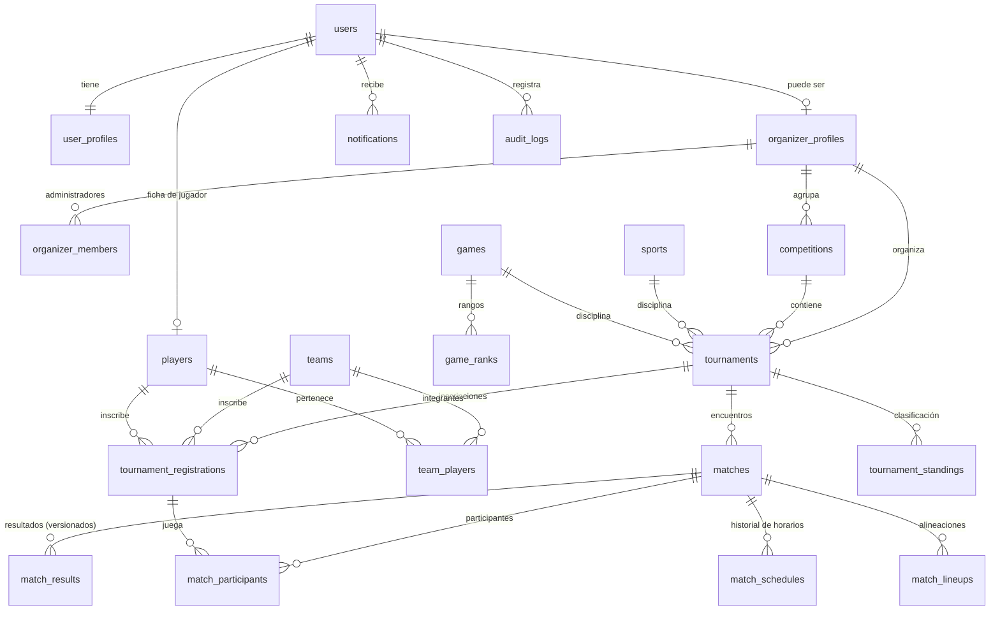
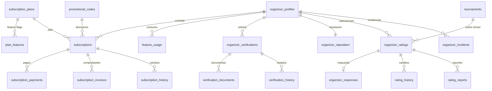
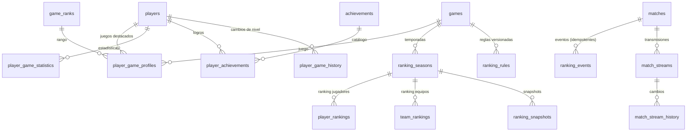

# Arquitectura

## Visión general

```
Navegador ──HTTP──▶ Next.js (apps/web) ──HTTP + JWT──▶ NestJS (apps/api) ──▶ PostgreSQL
    │                  │ Server Components / Actions          │
    │                  └ proxy.ts: renueva el JWT              ├──▶ S3 (logos, portadas, documentos privados)
    └──── WebSocket (socket.io /realtime) ◀────────────────────┘
```

- **La API es la única fuente de verdad.** Toda regla (límites de plan, propiedad de partidas, fechas, cupos,
  niveles requeridos) se valida en NestJS. El frontend solo muestra los mensajes que devuelve la API.
- **Sesión:** la API emite un JWT de acceso (15 min) y un refresh token (30 días, invalidable por
  `users.token_version`). Next.js los guarda en cookies `httpOnly`; el navegador nunca ve el refresh token.
  `proxy.ts` renueva el acceso antes de que expire y protege `/dashboard` con una comprobación optimista.
- **Preparada para app móvil:** la app móvil consumirá la misma API REST con el mismo flujo Bearer + refresh.
- **Tiempo real:** el gateway `/realtime` tiene salas `user:{id}` (notificaciones, requiere JWT en el handshake) y
  `tournament:{id}` (inscripciones, estado y horarios). La web refresca los datos del servidor al recibir eventos,
  sin recargar la página.

## Seguridad implementada

| Control | Dónde |
|---|---|
| JWT + verificación de cuenta activa y rol actual en cada request | `common/guards/auth.guards.ts` |
| RBAC (`@Roles`), SUPERADMIN con acceso total | `RolesGuard` |
| Aislamiento entre organizadores (`organizer_members`) | `common/utils/access.ts` |
| Lista blanca de campos (`whitelist` + `forbidNonWhitelisted`): impide auto-asignarse rol, plan o insignia | `app.setup.ts` |
| Límites de plan validados en transacción serializable al crear partidas | `plans/plans.ts`, `tournaments.service.ts` |
| Rate limiting global (120/min) y estricto en registro (5/min) e inicio de sesión (10/min) | `ThrottlerGuard` |
| Contraseñas bcrypt (12 rondas), comparación con hash señuelo para tiempos uniformes | `auth/auth.ts` |
| Subidas: tamaño máximo y tipo detectado por firma binaria, no por el `Content-Type` | `storage/storage.service.ts` |
| Documentos privados en bucket sin acceso público, URLs firmadas de 5 min | `StorageService.signedPrivateUrl` |
| Auditoría de acciones sensibles | `audit_logs`, `AuditService` |
| Helmet, CORS restringido, redes sociales solo `https` | `app.setup.ts`, `organizers.ts` |

## Modelo de datos

El esquema completo está en [`apps/api/prisma/schema.prisma`](../apps/api/prisma/schema.prisma). Las restricciones
que Prisma no expresa (índices únicos parciales, `CHECK`, índices trigram) están en
`prisma/migrations/*_constraints/migration.sql`:

- una solicitud de verificación abierta por organizador;
- una transmisión activa por partida (salvo retransmisiones);
- una suscripción vigente por organizador;
- inscripción con exactamente un equipo **o** un jugador;
- partida de deporte con `sport_id` o de eSport con `game_id`, nunca ambos;
- valoraciones entre 1 y 5; cuota ≥ 0; límite de inscripción ≤ inicio.

### Núcleo: usuarios, partidas y equipos



### SaaS, confianza y reputación



### Perfiles gamer, rankings y transmisiones



`ranking_events.event_reference` es único: procesar dos veces el mismo resultado no duplica puntos.
`season_id NULL` en `player_rankings` / `team_rankings` representa el ranking histórico acumulado.

## Reglas de negocio ya implementadas

- Cualquier usuario registrado puede activar su perfil de organizador; empieza en el plan FREE.
- Un torneo cuenta como **activo** en estado `DRAFT`, `OPEN` o `IN_PROGRESS`.
- Si una suscripción de pago vence (o sale del periodo de gracia en `PAST_DUE`) el organizador opera con los
  límites de FREE; sus partidas existentes no se borran.
- Flujo de estados de partida: `DRAFT → OPEN → IN_PROGRESS → FINISHED`, y cancelación desde cualquier estado no
  final, con motivo obligatorio y notificación a los inscritos.
- Un cambio de horario notifica a los inscritos aprobados.
- El organizador no puede inscribirse en su propia partida; la inscripción exige aceptar reglamento y condiciones.
- Retirar a un integrante conserva el historial (`left_at`); un equipo que ya compitió se archiva en vez de borrarse.
- La verificación, la reputación y el ranking no dependen del plan contratado.

### Fixture, resultados y clasificación

- El fixture se genera con la partida **en curso** a partir de los inscritos aprobados, en orden de siembra (o
  sorteando a los que no tienen siembra). Se puede regenerar mientras no haya resultados.
- **Eliminación simple y doble:** llave de la potencia de 2 siguiente con siembra estándar (1 vs N…); los byes van a
  los mejores sembrados y sus encuentros se eliminan: hay exactamente N-1 encuentros en eliminación simple. En doble
  eliminación los perdedores bajan a la llave de perdedores (cruzados para evitar revanchas) y la gran final es a un
  solo encuentro, sin reinicio de llave.
- **Liga:** todos contra todos por método circular. **Grupos:** reparto en serpiente; en grupos + playoffs, al
  completar los grupos se genera la llave final (1.º A vs 2.º B…).
- Los resultados son versionados: una corrección exige motivo, anula la versión anterior y queda auditada. En
  eliminación no hay empates: el desempate (penales, prórroga) indica quién avanza. Cambiar al ganador solo se admite
  si el encuentro siguiente aún no tiene resultado.
- La tabla se recalcula completa con cada resultado: puntos (configurables por partida), diferencia, anotados,
  victorias, enfrentamiento directo y siembra.
- Al **finalizar** la partida se exige el fixture completo y se fijan el campeón y las posiciones finales (en
  eliminación, los caídos en la misma ronda comparten puesto: 3.º-3.º, 5.º…).
- Cada reprogramación queda en `match_schedules` y se notifica a los participantes; los cambios llegan en tiempo real.

### Jugadores y estadísticas

- Cada usuario tiene una ficha de jugador. El dueño de un equipo puede agregar **jugadores sin cuenta**
  (`players.user_id NULL`, `manager_id` = quien los gestiona); no tienen ficha pública pero acumulan estadísticas.
- **Perfil gamer:** un perfil por videojuego (plataforma válida para el juego, rango del catálogo del juego). El nivel
  es *declarado* por el jugador; cambiar nivel o rango quita cualquier verificación previa y queda en
  `player_game_history`. Retirar un juego lo oculta sin borrar su historial.
- **Estadísticas oficiales:** solo cuentan torneos finalizados. En partidas por equipos se atribuyen a quien era
  integrante durante el torneo (según `team_players.joined_at/left_at`). Al finalizar un torneo se recalculan, dentro de
  la misma transacción, `player_game_statistics` y los logros (primer torneo, primera victoria, 10 y 50 victorias,
  campeón). El cálculo es idempotente y el seed lo usa para rellenar datos anteriores.
- **Privacidad:** la ficha pública oculta nombre real, país, estadísticas, equipos o historial según
  `user_profiles.privacy`; el propio jugador siempre ve todo.

## Sistema de confianza (Trust & Reputation System)

Dos indicadores **independientes** que nunca se combinan en una sola puntuación ni dependen del plan contratado:

### Indicador 1 · Organizador verificado

- Estados: `NOT_REQUESTED → PENDING → UNDER_REVIEW → VERIFIED | REJECTED`, y desde `VERIFIED`: `SUSPENDED` (y
  rehabilitación) o `EXPIRED`. El estado público se desnormaliza en `organizer_profiles.verification_status`; la fuente
  de verdad es `organizer_verifications` y cada cambio queda en `verification_history` (responsable, fecha, estados,
  motivo y observaciones internas) y en `audit_logs`.
- Una sola solicitud abierta por organizador (índice único parcial). Una rechazada o vencida admite una nueva solicitud;
  una suspendida solo la rehabilita el SUPERADMIN. La insignia se muestra únicamente en estado `VERIFIED`.
- Vigencia de 12 meses (configurable al aprobar o renovar). Un proceso horario vence las verificaciones, avisa 30 días
  antes y aplica la política de conservación.
- **Documentos:** bucket privado, tipo validado por firma binaria, acceso solo del SUPERADMIN mediante URL firmada de
  5 minutos (cada apertura queda auditada). Se eliminan 90 días después de una aprobación y 30 después de un rechazo.
- Nadie puede asignarse la insignia: los DTO rechazan campos no permitidos y las acciones son exclusivas del rol SUPERADMIN.

### Indicador 2 · Reputación

- **Elegibilidad para valorar:** partida `FINISHED`, inscripción aprobada con participación validada (al finalizar),
  como jugador, solicitante o integrante del equipo durante el torneo. El organizador y sus administradores no pueden
  valorar. Una valoración por usuario y torneo (restricción única), editable 7 días con historial en `rating_history`.
- **Fórmula:** organización 25 % + horarios 25 % + comunicación 20 % + transparencia 15 % + experiencia 15 %, sobre los
  promedios de las valoraciones con moderación `APPROVED`, con dos decimales.
- **Niveles:** `NEW` con menos de 10 valoraciones válidas o menos de 5 torneos completados; luego `INITIAL` (< 4.00),
  `GOOD` (4.00-4.49), `EXCELLENT` (4.50-4.79) y `TOP` (≥ 4.80). Siempre se muestran el número de valoraciones y la fecha
  de cálculo, y se advierte cuando la muestra es pequeña.
- **Cumplimiento:** completados / (completados + cancelaciones computables) × 100. Las partidas en curso no cuentan. Una
  cancelación no computa si no tenía participantes aprobados o si el SUPERADMIN la marca como justificada.
- **Incidencias:** las reportan participantes; solo las confirmadas (`RESOLVED`) se publican y se suman como indicador.
  No restan puntos de forma automática.
- **Anti-manipulación:** quedan pendientes de moderación (y no cuentan) las valoraciones de cuentas con menos de 24 h,
  con enlaces, con lenguaje ofensivo, con texto idéntico a otra o en ráfagas (≥ 10 por hora al mismo organizador). Tres
  reportes marcan una valoración para revisión. La moderación solo cambia la visibilidad (nunca las puntuaciones), exige
  justificación y queda auditada.
- **Recálculo:** el motor (`trust/reputation.ts`) recalcula desde cero tras cada valoración, edición, moderación,
  revisión de incidencia o cancelación y al finalizar/cancelar una partida; registra en auditoría cada cambio de
  puntuación o nivel. Las respuestas del organizador (una por valoración, editables 7 días) rechazan lenguaje ofensivo.
