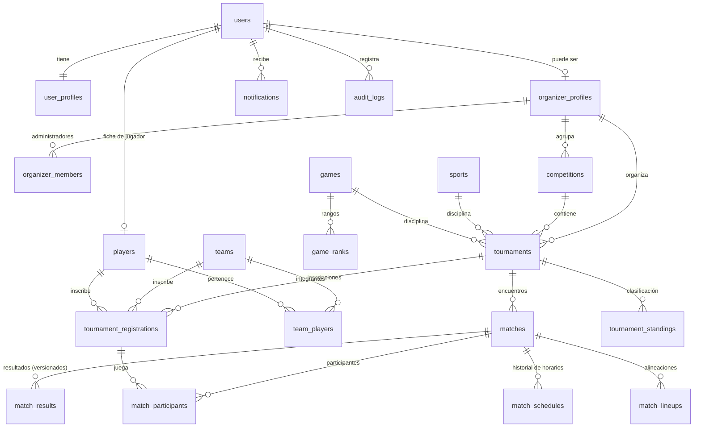
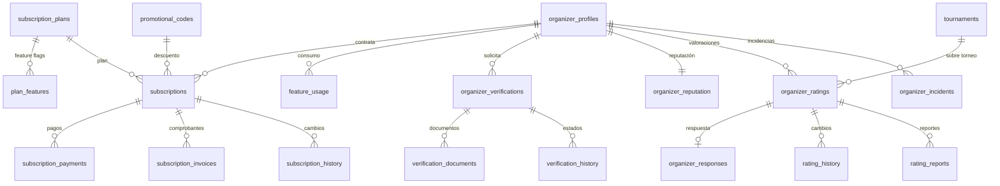
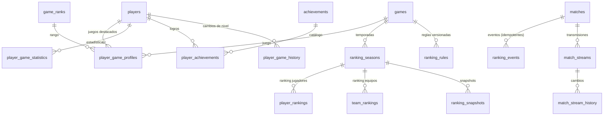

# Arquitectura

## Visión general

```
Navegador ──HTTP──▶ Next.js (apps/web) ──HTTP + JWT──▶ NestJS (apps/api) ──▶ PostgreSQL
    │                  │ Server Components / Actions          │
    │                  └ proxy.ts: renueva el JWT              ├──▶ S3 (logos, portadas, documentos privados)
    └──── WebSocket (socket.io /realtime) ◀────────────────────┘
```

- **La API es la única fuente de verdad.** Toda regla (límites de plan, propiedad de partidas, fechas, cupos,
  niveles requeridos) se valida en NestJS. El frontend solo muestra los mensajes que devuelve la API.
- **Sesión:** la API emite un JWT de acceso (15 min) y un refresh token (30 días, invalidable por
  `users.token_version`). Next.js los guarda en cookies `httpOnly`; el navegador nunca ve el refresh token.
  `proxy.ts` renueva el acceso antes de que expire y protege `/dashboard` con una comprobación optimista.
- **Preparada para app móvil:** la app móvil consumirá la misma API REST con el mismo flujo Bearer + refresh.
- **Tiempo real:** el gateway `/realtime` tiene salas `user:{id}` (notificaciones, requiere JWT en el handshake) y
  `tournament:{id}` (inscripciones, estado y horarios). La web refresca los datos del servidor al recibir eventos,
  sin recargar la página.

## Seguridad implementada

| Control | Dónde |
|---|---|
| JWT + verificación de cuenta activa y rol actual en cada request | `common/guards/auth.guards.ts` |
| RBAC (`@Roles`), SUPERADMIN con acceso total | `RolesGuard` |
| Aislamiento entre organizadores (`organizer_members`) | `common/utils/access.ts` |
| Lista blanca de campos (`whitelist` + `forbidNonWhitelisted`): impide auto-asignarse rol, plan o insignia | `app.setup.ts` |
| Límites de plan validados en transacción serializable al crear partidas | `plans/plans.ts`, `tournaments.service.ts` |
| Rate limiting global (120/min) y estricto en registro (5/min) e inicio de sesión (10/min) | `ThrottlerGuard` |
| Contraseñas bcrypt (12 rondas), comparación con hash señuelo para tiempos uniformes | `auth/auth.ts` |
| Subidas: tamaño máximo y tipo detectado por firma binaria, no por el `Content-Type` | `storage/storage.service.ts` |
| Documentos privados en bucket sin acceso público, URLs firmadas de 5 min | `StorageService.signedPrivateUrl` |
| Auditoría de acciones sensibles | `audit_logs`, `AuditService` |
| Helmet, CORS restringido, redes sociales solo `https` | `app.setup.ts`, `organizers.ts` |

## Modelo de datos

El esquema completo está en [`apps/api/prisma/schema.prisma`](../apps/api/prisma/schema.prisma). Las restricciones
que Prisma no expresa (índices únicos parciales, `CHECK`, índices trigram) están en
`prisma/migrations/*_constraints/migration.sql`:

- una solicitud de verificación abierta por organizador;
- una transmisión activa por partida (salvo retransmisiones);
- una suscripción vigente por organizador;
- inscripción con exactamente un equipo **o** un jugador;
- partida de deporte con `sport_id` o de eSport con `game_id`, nunca ambos;
- valoraciones entre 1 y 5; cuota ≥ 0; límite de inscripción ≤ inicio.

### Núcleo: usuarios, partidas y equipos



### SaaS, confianza y reputación



### Perfiles gamer, rankings y transmisiones



`ranking_events.event_reference` es único: procesar dos veces el mismo resultado no duplica puntos.
`season_id NULL` en `player_rankings` / `team_rankings` representa el ranking histórico acumulado.
`match_lineups` guarda qué integrantes representaron a cada equipo en cada encuentro y `ranking_result_reports` los
reportes de resultados incorrectos.

## Reglas de negocio ya implementadas

- Cualquier usuario registrado puede activar su perfil de organizador; empieza en el plan FREE.
- Un torneo cuenta como **activo** en estado `DRAFT`, `OPEN` o `IN_PROGRESS`.
- Si una suscripción de pago vence (o sale del periodo de gracia en `PAST_DUE`) el organizador opera con los
  límites de FREE; sus partidas existentes no se borran.

### Suscripciones y pagos (módulo 17)

- **Solo pagos de la plataforma:** `subscription_payments` cobra la suscripción del organizador; las cuotas de
  inscripción de los torneos son informativas y nunca pasan por este módulo.
- **El organizador no fija su plan:** el plan solo cambia al confirmarse un pago (webhook o pago de prueba), al
  aplicarse un cambio programado o por el ciclo de vida. Los DTO no aceptan `status` ni `planId`.
- **Cotización** (`billing/pricing.ts`, funciones puras con pruebas): subir de plan o pasar de mensual a anual cobra de
  inmediato descontando el saldo no usado del periodo pagado; bajar de plan o pasar a mensual queda programado
  (`pending_plan_id`) para el fin del periodo; pasar a un plan gratuito es una cancelación al final del periodo. El
  cupón (`promotional_codes`) se descuenta del pago en que se ingresa y suma un uso al confirmarse.
- **Proveedores** (`billing/providers.ts`): Stripe Checkout y Mercado Pago Checkout Pro por su API REST, cada uno
  habilitado solo con clave y secreto de webhook. Fuera de producción existe un pago de prueba (`SANDBOX`) que recorre
  el mismo procesamiento de eventos. Son pagos por periodo, sin cobro recurrente en el proveedor: la renovación la
  inicia el organizador cuando Arena le avisa.
- **Idempotencia y seguridad:** cada checkout lleva una clave de idempotencia del cliente (`idempotency_key` única) que
  también se envía al proveedor; hay un solo pago pendiente por organizador; los webhooks se validan por firma
  (HMAC-SHA256 con tolerancia de tiempo), se registran en `payment_webhook_events` (único por proveedor + evento) y se
  aplican con un candado por organizador (`pg_advisory_xact_lock`). Un evento cuyo importe o moneda no coincide se
  registra y se ignora.
- **Ciclo de vida** (cada 10 minutos): pagos sin completar en 24 h se anulan; aviso 7 días antes del fin del periodo
  (3 en la prueba); al vencer, la cancelación o la prueba sin pago cierran la suscripción y abren una FREE vigente, un
  cambio programado se aplica, y si no, pasa a `PAST_DUE` con los días de gracia del plan; tras la gracia, `EXPIRED` y
  FREE. Cada transición queda en `subscription_history` y en la auditoría.
- **Comprobantes:** numeración correlativa `ARN-AAAA-000001` (secuencia de Postgres) al confirmarse cada pago.
- **Planes configurables:** el código de plan es texto, así que SUPERADMIN crea planes nuevos sin migraciones; Free es
  el plan de respaldo (sin precio, siempre activo). El seed solo crea los planes que faltan y no pisa precios editados.
- **Métricas:** MRR con lo efectivamente cobrado (descuentos incluidos) normalizado a mes; ARPU = MRR / organizadores;
  churn = suscripciones de pago terminadas en 30 días sobre las de pago vigentes más esas; importes agrupados por moneda.
- Flujo de estados de partida: `DRAFT → OPEN → IN_PROGRESS → FINISHED`, y cancelación desde cualquier estado no
  final, con motivo obligatorio y notificación a los inscritos.
- Un cambio de horario notifica a los inscritos aprobados.
- El organizador no puede inscribirse en su propia partida; la inscripción exige aceptar reglamento y condiciones.
- Retirar a un integrante conserva el historial (`left_at`); un equipo que ya compitió se archiva en vez de borrarse.
- La verificación, la reputación y el ranking no dependen del plan contratado.

### Estadísticas (fase 6)

- `dashboard/stats.ts` agrega todo en Postgres con SQL parametrizado; el mismo servicio sirve al organizador (filtrado
  por `organizer_id`) y a SUPERADMIN (sin filtro). Las funciones de periodo, ratio, variación y CSV son puras y tienen
  pruebas.
- **Periodo:** N meses calendario en UTC que incluyen el mes en curso, comparados con los N meses anteriores.
  Inscripciones y encuentros cuentan hasta hoy; las partidas se fechan por su inicio (o su cierre si terminó antes) y
  cuentan hasta el fin del mes en curso.
- **Definiciones:** aprobación = aprobadas / (aprobadas + rechazadas); ocupación = inscritos aprobados / cupos de las
  partidas del periodo (sin borradores ni canceladas); encuentro jugado = `COMPLETED` con dos participantes, fechado por
  su primer resultado validado; participante = equipo o jugador; nuevo = primera inscripción aprobada con el organizador
  dentro del periodo; recurrente = jugó más de una partida del organizador. Un ratio sin base es `null` (se muestra «—»).
- **Planes:** estadísticas avanzadas con `ADVANCED_STATS`, exportación con `EXPORT_REPORTS` (PRO y BUSINESS) y reporte
  ejecutivo con `EXECUTIVE_REPORTS` (BUSINESS), validados en la API. La web descarga el CSV mediante una ruta
  (`/dashboard/estadisticas/exportar/[kind]`) que adjunta el JWT de la cookie httpOnly.

### Fixture, resultados y clasificación

- El fixture se genera con la partida **en curso** a partir de los inscritos aprobados, en orden de siembra (o
  sorteando a los que no tienen siembra). Se puede regenerar mientras no haya resultados.
- **Eliminación simple y doble:** llave de la potencia de 2 siguiente con siembra estándar (1 vs N…); los byes van a
  los mejores sembrados y sus encuentros se eliminan: hay exactamente N-1 encuentros en eliminación simple. En doble
  eliminación los perdedores bajan a la llave de perdedores (cruzados para evitar revanchas) y la gran final es a un
  solo encuentro, sin reinicio de llave.
- **Liga:** todos contra todos por método circular. **Grupos:** reparto en serpiente; en grupos + playoffs, al
  completar los grupos se genera la llave final (1.º A vs 2.º B…).
- Los resultados son versionados: una corrección exige motivo, anula la versión anterior y queda auditada. En
  eliminación no hay empates: el desempate (penales, prórroga) indica quién avanza. Cambiar al ganador solo se admite
  si el encuentro siguiente aún no tiene resultado.
- La tabla se recalcula completa con cada resultado: puntos (configurables por partida), diferencia, anotados,
  victorias, enfrentamiento directo y siembra.
- Al **finalizar** la partida se exige el fixture completo y se fijan el campeón y las posiciones finales (en
  eliminación, los caídos en la misma ronda comparten puesto: 3.º-3.º, 5.º…).
- Cada reprogramación queda en `match_schedules` y se notifica a los participantes; los cambios llegan en tiempo real.

### Jugadores y estadísticas

- Cada usuario tiene una ficha de jugador. El dueño de un equipo puede agregar **jugadores sin cuenta**
  (`players.user_id NULL`, `manager_id` = quien los gestiona); no tienen ficha pública pero acumulan estadísticas.
- **Perfil gamer:** un perfil por videojuego (plataforma válida para el juego, rango del catálogo del juego), con
  orden, juego principal, favorito y visibilidad pública. Retirar un juego lo oculta sin borrar su historial.
- **Origen del nivel** (nunca se presenta un nivel declarado como certificado; siempre se muestran origen y fecha):
  - `SELF_DECLARED`: lo elige el jugador. Cada cambio de nivel o rango queda en `player_game_history`.
  - `PLATFORM_VERIFIED`: automático (`players/levels.ts`). Las estadísticas oficiales del juego respaldan el nivel
    declarado si este es igual o inferior al que alcanzan los umbrales (partidas, % de victorias y títulos; mínimo 5
    partidas). Se reevalúa al cerrar cada torneo y cuando el jugador cambia su nivel; si deja de estar respaldado vuelve a
    declarado. Solo respalda el nivel general: el rango del juego sigue siendo declarado.
  - `EXTERNAL_VERIFIED`: lo registra un SUPERADMIN con la fuente externa autorizada y una justificación (auditoría y
    notificación). Las estadísticas no lo pisan; si el jugador declara otro nivel o rango, vuelve a declarado.
- **Comparador:** 2-4 jugadores dentro de un mismo videojuego; los rangos solo se comparan dentro del catálogo de ese
  juego. Respeta la privacidad de cada jugador (estadísticas e historial).
- **Reclutamiento:** búsqueda por juego, nivel, rango mínimo, rol, plataforma, disponibilidad, equipo actual y origen del
  nivel. El dueño de un equipo invita a jugadores con cuenta; el jugador acepta o rechaza. Las invitaciones pendientes
  caducan a los 14 días y no se duplican.
- **Requisitos de las partidas:** nivel y rango mínimos/máximos (rangos validados contra el juego de la partida). Se
  comprueban al inscribirse con el perfil gamer del jugador; en partidas por equipos, con el de cada integrante actual. El
  organizador filtra las inscripciones por nivel y ve rango, origen y estadísticas de cada jugador.
- **Estadísticas oficiales:** solo cuentan torneos finalizados. En partidas por equipos se atribuyen a quien era
  integrante durante el torneo (según `team_players.joined_at/left_at`). Al finalizar un torneo se recalculan, dentro de
  la misma transacción, `player_game_statistics`, los logros (primer torneo, primera victoria, 10 y 50 victorias,
  campeón, tres títulos consecutivos) y el respaldo de nivel. El cálculo es idempotente y el seed lo usa para rellenar
  datos anteriores.
- **Jugador destacado (MVP):** lo elige el organizador en una partida finalizada entre sus participantes y genera el logro
  correspondiente. Si corrige la elección, el logro se retira al anterior salvo que lo respalde otra partida.
- **Privacidad:** la ficha pública oculta nombre real, país, estadísticas, equipos o historial según
  `user_profiles.privacy`; el propio jugador siempre ve todo.

### Ranking global (módulo 22)

- **Motor** (`rankings/engine.ts`, servicio `RankingEngineService`): al finalizar un torneo de videojuego que puntúa
  (`is_ranked`), genera eventos por cada encuentro con resultado `VALIDATED` (victoria/empate/derrota + participación) y
  por el puesto final. Corre tras confirmar el cierre, en su propia transacción con un bloqueo por juego; si falla, el
  cierre no se revierte y cualquier recálculo lo corrige.
- **Idempotencia y trazabilidad:** la `event_reference` incluye torneo, encuentro, versión del resultado, versión de la
  regla y puntos. Si algo cambia (regla, nivel del torneo), el evento anterior queda revertido y se crea otro; nunca se
  borra. Las reversiones administrativas (`reverted_by_id`) no se deshacen al recalcular.
- **Puntuación:** configurable y versionada por juego y modalidad (`ranking_rules`): victoria, empate, derrota,
  participación, puntos por puesto, multiplicador por nivel del torneo (1-5, solo lo fija el SUPERADMIN) y tope por
  torneo. Se aplica la versión `ACTIVE` vigente en la fecha de cierre; sin regla, los valores base (25/10/0/5,
  100/60/40). Una versión activa no se edita: se crea otra. La calidad del rival y las estadísticas propias de cada
  juego aún no ponderan.
- **Clasificaciones:** se reconstruyen desde los eventos no revertidos para el histórico y cada temporada `ACTIVE`
  (eventos dentro de sus fechas; las nacionales, solo participantes de ese país). Orden: puntos, victorias, títulos;
  empate total comparte posición. Las temporadas cerradas quedan congeladas con su campeón individual y por equipos.
- **Elegibilidad:** perfil gamer activo del juego (jugadores), cuenta y ficha no suspendidas, sin suspensión temporal del
  ranking y el mínimo de encuentros de la regla o temporada. Si no, aparece como provisional.
- **Equipos:** los puntos son del equipo que disputó la competición; sus integrantes los suman en el ranking individual
  según la alineación registrada en ese momento. Cambiar la plantilla no traslada puntos.
- **Evolución:** cada recálculo guarda el snapshot del día (y un proceso cada 6 h garantiza uno diario). ↑ ↓ = NEW
  compara con el snapshot anterior; los gráficos usan el último snapshot de cada semana.
- **Anti-manipulación:** solo resultados validados; reportes de resultados por los participantes (30 días); revisión
  SUPERADMIN que, si procede, revierte los puntos del encuentro sin tocar el resultado original; señales de
  enfrentamientos repetidos y de puntos concentrados en un organizador. Toda acción administrativa queda en
  `ranking_audit_logs`. La reputación, la verificación y el plan del organizador no intervienen.

### Transmisiones en vivo (módulo 23)

- **Por encuentro, no por torneo:** `match_streams` admite una transmisión principal activa por encuentro (índice único
  parcial) y retransmisiones adicionales marcadas `is_rebroadcast`. Quitar el enlace la deja inactiva: nunca se borra y
  `match_stream_history` guarda enlace y estado anterior y nuevo, autor y motivo de cada cambio.
- **Validación de enlaces** (`streams/platforms.ts`, funciones puras con pruebas): solo HTTPS, sin credenciales, puertos,
  IP ni caracteres de control; la plataforma se detecta por el dominio contra una lista cerrada (YouTube, Twitch,
  Facebook, TikTok, Kick y otras como Vimeo o Trovo, ampliable con `STREAM_EXTRA_DOMAINS`). Si el organizador indica una
  plataforma distinta de la detectada, se rechaza. Al leer se vuelve a validar: un dominio retirado de la lista deja de
  mostrarse.
- **Reproductor embebido:** la API solo entrega `{ provider, id }`; la web arma el `src` con sus propios hosts de
  reproductor, en un iframe con `sandbox`, `referrerPolicy` y carga bajo demanda (no se contacta a terceros hasta que el
  usuario pulsa). `next.config.ts` fija `frame-src` a esos mismos hosts y `frame-ancestors 'self'`. Siempre queda el
  enlace directo (`noopener noreferrer`) como alternativa; TikTok Live y los canales sin video concreto son solo enlace.
- **Estados:** `SCHEDULED → LIVE → ENDED`, cancelación desde programada o en vivo, reanudar y reprogramar. Sin enlace, el
  encuentro informa `NOT_CONFIGURED` y funciona igual que antes. Al generar el fixture se puede programar un mismo canal
  para todos los encuentros.
- **Privacidad:** las privadas solo entregan el enlace al organizador y a los participantes del encuentro; no aparecen
  en `/streams/*` ni en las listas del torneo para el resto.
- **Avisos:** en vivo, cambio de enlace y cancelación al activarse; «próxima a transmitirse» 30 minutos antes, revisado
  cada 5 minutos con una marca (`upcoming_notified_at`) reclamada de forma atómica para no duplicar. Destinatarios: los
  inscritos aprobados del torneo (públicas) o los participantes del encuentro (privadas), sin incluir a quien hizo el
  cambio. Cada usuario decide por tipo y canal en `notification_preferences`; el canal en la plataforma es inmediato y
  email/WhatsApp quedan registrados para un proveedor de envío que aún no está conectado.

## Sistema de confianza (Trust & Reputation System)

Dos indicadores **independientes** que nunca se combinan en una sola puntuación ni dependen del plan contratado:

### Indicador 1 · Organizador verificado

- Estados: `NOT_REQUESTED → PENDING → UNDER_REVIEW → VERIFIED | REJECTED`, y desde `VERIFIED`: `SUSPENDED` (y
  rehabilitación) o `EXPIRED`. El estado público se desnormaliza en `organizer_profiles.verification_status`; la fuente
  de verdad es `organizer_verifications` y cada cambio queda en `verification_history` (responsable, fecha, estados,
  motivo y observaciones internas) y en `audit_logs`.
- Una sola solicitud abierta por organizador (índice único parcial). Una rechazada o vencida admite una nueva solicitud;
  una suspendida solo la rehabilita el SUPERADMIN. La insignia se muestra únicamente en estado `VERIFIED`.
- Vigencia de 12 meses (configurable al aprobar o renovar). Un proceso horario vence las verificaciones, avisa 30 días
  antes y aplica la política de conservación.
- **Documentos:** bucket privado, tipo validado por firma binaria, acceso solo del SUPERADMIN mediante URL firmada de
  5 minutos (cada apertura queda auditada). Se eliminan 90 días después de una aprobación y 30 después de un rechazo.
- Nadie puede asignarse la insignia: los DTO rechazan campos no permitidos y las acciones son exclusivas del rol SUPERADMIN.

### Indicador 2 · Reputación

- **Elegibilidad para valorar:** partida `FINISHED`, inscripción aprobada con participación validada (al finalizar),
  como jugador, solicitante o integrante del equipo durante el torneo. El organizador y sus administradores no pueden
  valorar. Una valoración por usuario y torneo (restricción única), editable 7 días con historial en `rating_history`.
- **Fórmula:** organización 25 % + horarios 25 % + comunicación 20 % + transparencia 15 % + experiencia 15 %, sobre los
  promedios de las valoraciones con moderación `APPROVED`, con dos decimales.
- **Niveles:** `NEW` con menos de 10 valoraciones válidas o menos de 5 torneos completados; luego `INITIAL` (< 4.00),
  `GOOD` (4.00-4.49), `EXCELLENT` (4.50-4.79) y `TOP` (≥ 4.80). Siempre se muestran el número de valoraciones y la fecha
  de cálculo, y se advierte cuando la muestra es pequeña.
- **Cumplimiento:** completados / (completados + cancelaciones computables) × 100. Las partidas en curso no cuentan. Una
  cancelación no computa si no tenía participantes aprobados o si el SUPERADMIN la marca como justificada.
- **Incidencias:** las reportan participantes; solo las confirmadas (`RESOLVED`) se publican y se suman como indicador.
  No restan puntos de forma automática.
- **Anti-manipulación:** quedan pendientes de moderación (y no cuentan) las valoraciones de cuentas con menos de 24 h,
  con enlaces, con lenguaje ofensivo, con texto idéntico a otra o en ráfagas (≥ 10 por hora al mismo organizador). Tres
  reportes marcan una valoración para revisión. La moderación solo cambia la visibilidad (nunca las puntuaciones), exige
  justificación y queda auditada.
- **Recálculo:** el motor (`trust/reputation.ts`) recalcula desde cero tras cada valoración, edición, moderación,
  revisión de incidencia o cancelación y al finalizar/cancelar una partida; registra en auditoría cada cambio de
  puntuación o nivel. Las respuestas del organizador (una por valoración, editables 7 días) rechazan lenguaje ofensivo.
