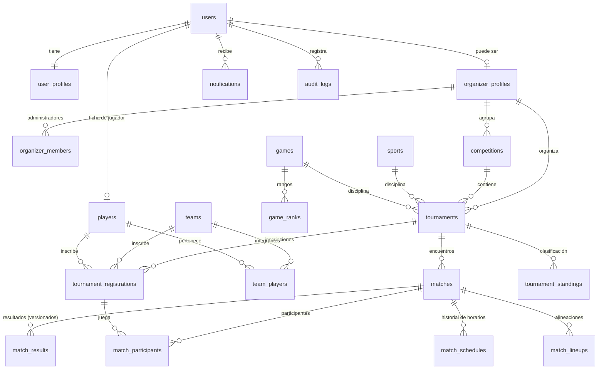
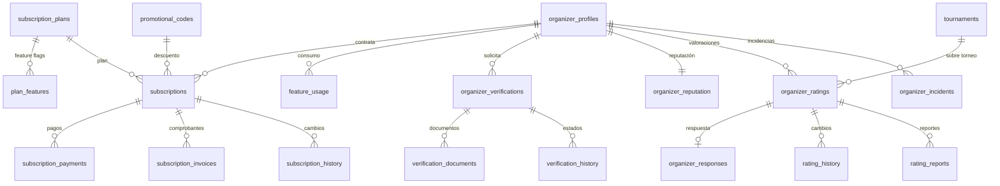
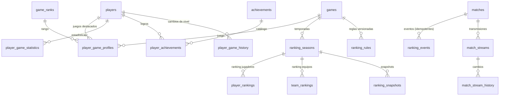

# Arquitectura

## Visión general

```
Navegador ──HTTP──▶ Next.js (apps/web) ──HTTP + JWT──▶ NestJS (apps/api) ──▶ PostgreSQL
    │                  │ Server Components / Actions          │
    │                  └ proxy.ts: renueva el JWT              ├──▶ S3 (logos, portadas, documentos privados)
    └──── WebSocket (socket.io /realtime) ◀────────────────────┘
```

- **La API es la única fuente de verdad.** Toda regla (límites de plan, propiedad de partidas, fechas, cupos,
  niveles requeridos) se valida en NestJS. El frontend solo muestra los mensajes que devuelve la API.
- **Sesión:** la API emite un JWT de acceso (15 min) y un refresh token (30 días, invalidable por
  `users.token_version`). Next.js los guarda en cookies `httpOnly`; el navegador nunca ve el refresh token.
  `proxy.ts` renueva el acceso antes de que expire y protege `/dashboard` con una comprobación optimista.
- **Preparada para app móvil:** la app móvil consumirá la misma API REST con el mismo flujo Bearer + refresh.
- **Tiempo real:** el gateway `/realtime` tiene salas `user:{id}` (notificaciones, requiere JWT en el handshake) y
  `tournament:{id}` (inscripciones, estado y horarios). La web refresca los datos del servidor al recibir eventos,
  sin recargar la página.

## Seguridad implementada

| Control | Dónde |
|---|---|
| JWT + verificación de cuenta activa y rol actual en cada request | `common/guards/auth.guards.ts` |
| RBAC (`@Roles`), SUPERADMIN con acceso total | `RolesGuard` |
| Aislamiento entre organizadores (`organizer_members`) | `common/utils/access.ts` |
| Lista blanca de campos (`whitelist` + `forbidNonWhitelisted`): impide auto-asignarse rol, plan o insignia | `app.setup.ts` |
| Límites de plan validados en transacción serializable al crear partidas | `plans/plans.ts`, `tournaments.service.ts` |
| Rate limiting global (120/min) y estricto en registro (5/min) e inicio de sesión (10/min) | `ThrottlerGuard` |
| Contraseñas bcrypt (12 rondas), comparación con hash señuelo para tiempos uniformes | `auth/auth.ts` |
| Subidas: tamaño máximo y tipo detectado por firma binaria, no por el `Content-Type` | `storage/storage.service.ts` |
| Documentos privados en bucket sin acceso público, URLs firmadas de 5 min | `StorageService.signedPrivateUrl` |
| Auditoría de acciones sensibles | `audit_logs`, `AuditService` |
| Helmet, CORS restringido, redes sociales solo `https` | `app.setup.ts`, `organizers.ts` |

## Modelo de datos

El esquema completo está en [`apps/api/prisma/schema.prisma`](../apps/api/prisma/schema.prisma). Las restricciones
que Prisma no expresa (índices únicos parciales, `CHECK`, índices trigram) están en
`prisma/migrations/*_constraints/migration.sql`:

- una solicitud de verificación abierta por organizador;
- una transmisión activa por partida (salvo retransmisiones);
- una suscripción vigente por organizador;
- inscripción con exactamente un equipo **o** un jugador;
- partida de deporte con `sport_id` o de eSport con `game_id`, nunca ambos;
- valoraciones entre 1 y 5; cuota ≥ 0; límite de inscripción ≤ inicio.

### Núcleo: usuarios, partidas y equipos



### SaaS, confianza y reputación



### Perfiles gamer, rankings y transmisiones



`ranking_events.event_reference` es único: procesar dos veces el mismo resultado no duplica puntos.
`season_id NULL` en `player_rankings` / `team_rankings` representa el ranking histórico acumulado.

## Reglas de negocio ya implementadas

- Cualquier usuario registrado puede activar su perfil de organizador; empieza en el plan FREE.
- Un torneo cuenta como **activo** en estado `DRAFT`, `OPEN` o `IN_PROGRESS`.
- Si una suscripción de pago vence (o sale del periodo de gracia en `PAST_DUE`) el organizador opera con los
  límites de FREE; sus partidas existentes no se borran.
- Flujo de estados de partida: `DRAFT → OPEN → IN_PROGRESS → FINISHED`, y cancelación desde cualquier estado no
  final, con motivo obligatorio y notificación a los inscritos.
- Un cambio de horario notifica a los inscritos aprobados.
- El organizador no puede inscribirse en su propia partida; la inscripción exige aceptar reglamento y condiciones.
- Retirar a un integrante conserva el historial (`left_at`); un equipo que ya compitió se archiva en vez de borrarse.
- La verificación, la reputación y el ranking no dependen del plan contratado.
